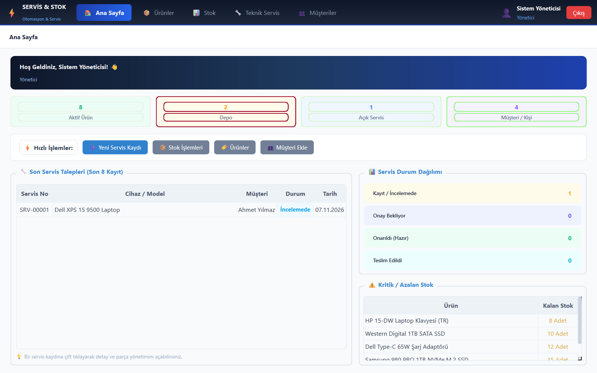
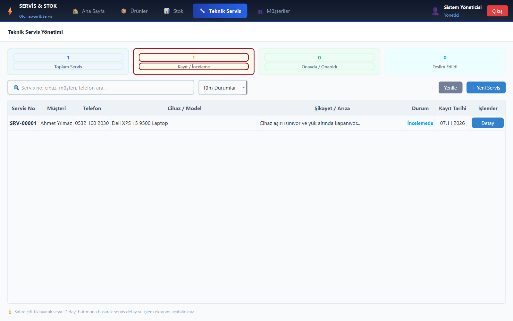
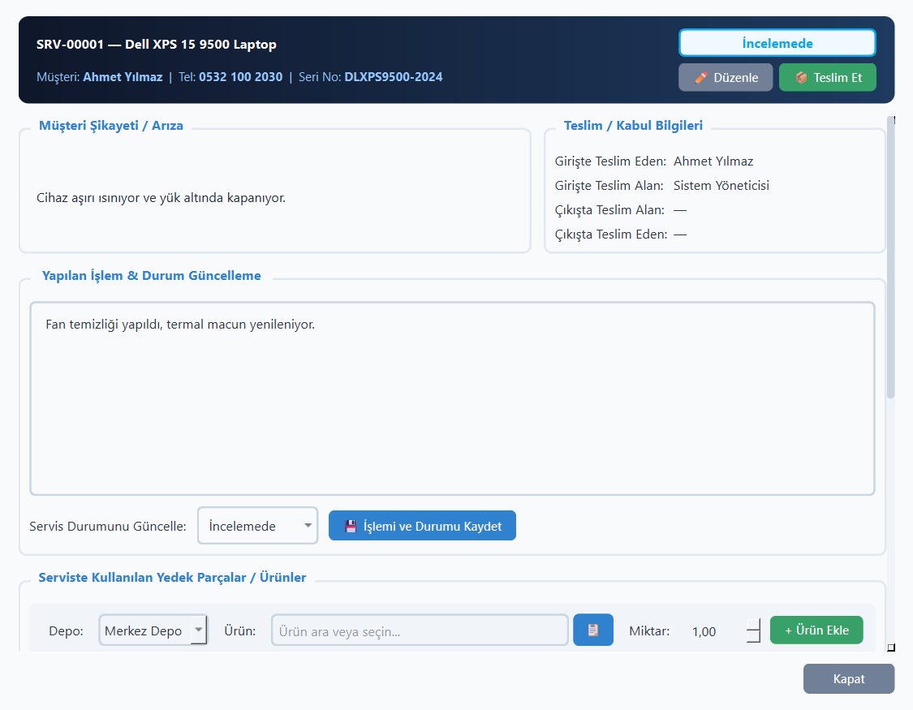
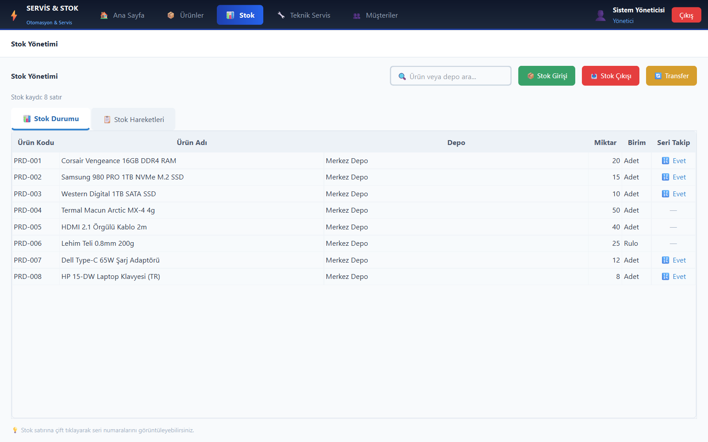
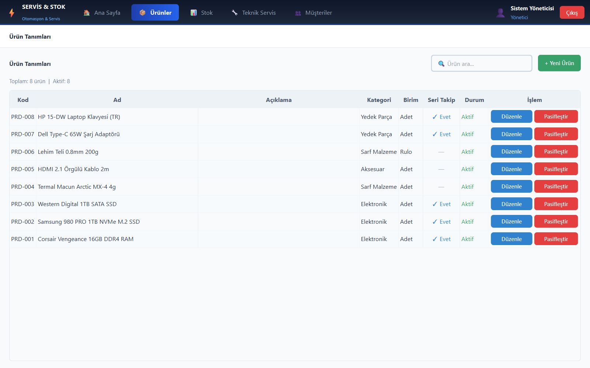
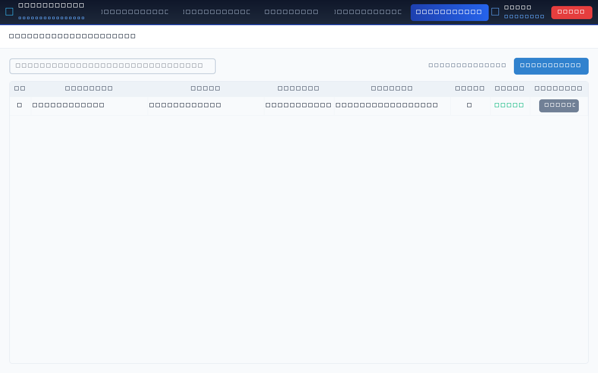
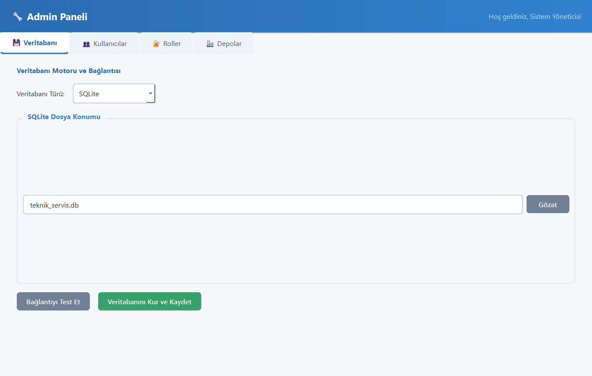
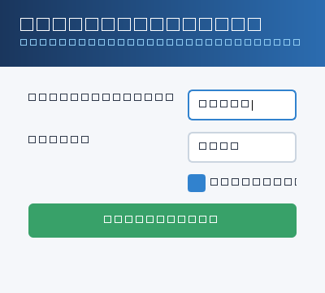

# Technical Service & Inventory Management System (ServicePro)

[](https://www.python.org/)
[](https://riverbankcomputing.com/software/pyqt/)
[](https://www.sqlalchemy.org/)
[]()
[](https://opensource.org/licenses/MIT)

An enterprise-grade desktop software developed with **PyQt6** and **SQLAlchemy 2.0+** designed for end-to-end **inventory tracking**, **serial number lifecycle**, and **technical service workflow automation**.

---

## 📸 Screenshots

| Dashboard & Overview | Technical Service Workflow |
|:---:|:---:|
|  |  |

| Service Detail & Spare Parts | Stock & Warehouse Levels |
|:---:|:---:|
|  |  |

| Product Catalog | Customers & Contacts |
|:---:|:---:|
|  |  |

| Admin Panel & Multi-DB Setup | User Authentication |
|:---:|:---:|
|  |  |

---

## 🌟 Key Features

### 1. Dual-Application Architecture
- **Admin Panel (`admin_app`):** First-time setup wizard, database dialect selection (SQLite, PostgreSQL, MSSQL), role-based access control (RBAC with granular permissions: `can_view`, `can_create`, `can_edit`, `can_delete`, `can_manage`), warehouse definition.
- **Staff Client (`main_app`):** Secure login, real-time KPI dashboard, dynamic stock operations, technical service ticketing, customer phonebook.

### 2. Dynamic Inventory Calculation
- Inventory quantities are never stored as static counter fields. Stock levels are calculated dynamically from atomic ledger entries (`StockMovement`: `IN`, `OUT`, `TRANSFER_IN`, `TRANSFER_OUT`, `SERVICE_OUT`).
- Eliminates race conditions and concurrency discrepancies.

### 3. Strict Serial Number Tracking
- For products with serial tracking enabled:
  - **Stock In:** Quantity must match exact batch of serial numbers entered.
  - **Stock Out / Service Consumption:** Only unassigned (`available`) serials can be selected. The system automatically locks used serial numbers (`status='used'`) and safely releases them back to warehouse inventory if an item is revoked.

### 4. Technical Service & Repair Automation
- **Sequential Ticket Numbering:** Unique automatic generation (`SRV-00001` format).
- **Audit History:** Full chronological timeline (`ServiceHistory`) recording every status transition (`Received`, `In Review`, `Pending Approval`, `Repaired`, `Delivered`, `Cancelled`) with technician ID and timestamp.
- **Spare Part Deduction:** Parts consumed during repair are immediately deducted from the selected warehouse with associated serial numbers.
- **Handover Protocol:** Digital recording of recipient, delivering staff, and closing notes upon handover.

### 5. Multi-Database Engine Support
- **SQLite:** Out-of-the-box local database with zero configuration.
- **PostgreSQL:** Production-grade networking support via `psycopg2`.
- **Microsoft SQL Server (MSSQL):** Enterprise Windows integration via `pyodbc`.

### 6. Turkish & International Character Normalization
- Two-way fuzzy search matching insensitive to ASCII / Turkish letter cases (`ı/i`, `İ/i`, `ş/s`, `ç/c`, `ö/o`, `ü/u`, `ğ/g`).

---

## 🚀 Getting Started

### Prerequisites
- Python 3.10+ (tested on Python 3.12)
- Git

### Installation

1. Clone the repository:
   ```bash
   git clone https://github.com/farukiskender/technical-service-inventory-management.git
   cd technical-service-inventory-management
   ```

2. Create and activate a virtual environment:
   ```bash
   # Windows:
   python -m venv venv
   venv\Scripts\activate

   # Linux / macOS:
   python3 -m venv venv
   source venv/bin/activate
   ```

3. Install required dependencies:
   ```bash
   pip install -r requirements.txt
   ```

---

## 🏃 Launching the Application

### Windows
- **Admin App:** Double click `Admin_Baslat.bat` or run:
  ```bash
  python admin_app/main.py
  ```
- **Main Client:** Double click `Uygulama_Baslat.bat` or run:
  ```bash
  python main_app/main.py
  ```

### Linux / macOS
```bash
chmod +x admin_baslat.sh uygulama_baslat.sh

# Admin Panel:
./admin_baslat.sh

# Main Client:
./uygulama_baslat.sh
```

---

## 🔐 Default Credentials

Fresh installations come with a default administrator account:
- **Username:** `admin`
- **Password:** `1234`

*(Credentials can be modified anytime through the Admin Panel).*

---

## 🧪 Optional: Populating Sample Demo Data

To populate sample products, warehouses, customers, and service tickets for testing purposes:
```bash
python seed_demo.py
```

---

## 📁 Repository Structure

```text
├── admin_app/              # Admin application & setup wizard
│   ├── main.py             # Admin UI, DB selector, user & role management
│   └── __init__.py
├── main_app/               # Staff client application
│   ├── login.py            # Authentication dialog & remember-me logic
│   ├── main.py             # Main entrypoint
│   ├── main_window.py      # Dashboard & navigation shell
│   └── ui/                 # Module pages
│       ├── stock_page.py   # Stock movements & serial number dialogs
│       ├── service_page.py # Repair tickets & spare parts management
│       ├── products_page.py# Catalog & unit definitions
│       └── persons_page.py # Customer & contact management
├── shared/                 # Shared domain models & utilities
│   ├── schema.py           # SQLAlchemy ORM models & multi-engine connector
│   ├── utils.py            # Turkish & case-insensitive normalization
│   └── db_config.json      # Connection configuration
├── screenshots/            # In-app UI screenshots
├── seed_demo.py            # Demo dataset seeder
├── requirements.txt        # Python package requirements
├── Admin_Baslat.bat        # Windows launcher (Admin)
└── Uygulama_Baslat.bat     # Windows launcher (Client)
```

---

## 📄 License
This project is licensed under the MIT License - see the [LICENSE](LICENSE) file for details.
